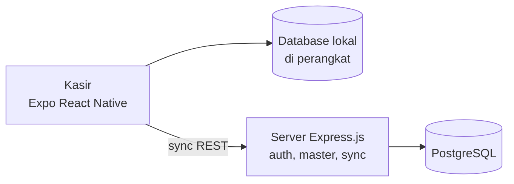

# NurCake POS — Kasir Mobile Toko Kue

> Aplikasi kasir (point of sale) mobile untuk toko kue NurCake: katalog produk dan harga, transaksi, buku pesanan, lacak pesanan, dan laporan penjualan. Aplikasi bekerja di perangkat dan menyinkronkan data ke server.

| | |
|---|---|
| Klien | NurCake (unit usaha Nur Group) |
| Peran saya | Developer tunggal: aplikasi mobile dan server sinkronisasi |
| Status | Selesai |

## Fitur utama

- **Kasir (POS)**: pilih produk, hitung total, catat transaksi.
- **Kelola produk dan harga**.
- **Buku pesanan** untuk pesanan kue custom, dan **lacak pesanan** sampai diambil.
- **Riwayat transaksi** dan **laporan penjualan**.
- **Sinkronisasi** data master dan transaksi antara perangkat dan server; backup basis data terjadwal.

## Arsitektur

## Tech stack

| Lapis | Teknologi |
|---|---|
| Mobile | Expo React Native, Expo Router, TypeScript |
| Penyimpanan lokal | SQLite di perangkat, pola repository |
| Server | Node.js, Express.js, Helmet, Morgan |
| Data server | PostgreSQL |
| Build | EAS Build (Android) |

---

> **Catatan kerahasiaan.** Kode sumber aplikasi ini private karena milik/dipakai instansi. Repo ini hanya menjelaskan konteks, fitur, arsitektur, dan peran saya. Tidak ada kode, data pegawai, data pasien, alamat server, maupun kredensial di sini.

**Maizan Insani Akbar** · Software Engineer & System Analyst · [Portfolio](https://izanmaizan.vercel.app) · [LinkedIn](https://www.linkedin.com/in/izanmaizan/) · [GitHub](https://github.com/izanmaizan)
